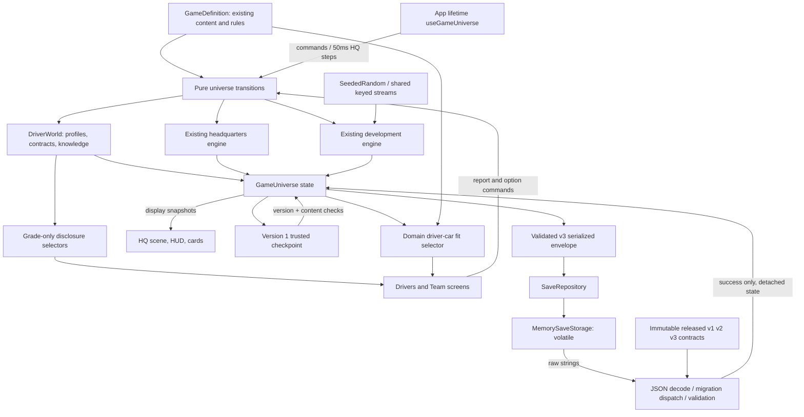

# System map

Solid connections below exist today. Everything in the future table is design, not working code.

| Boundary | Data passed | Must not happen |
|---|---|---|
| App -> HQ transition | Latest universe, definition, finite dt | Frame time advancing weeks |
| Explicit week command -> development | Existing world/context | React implementing project rules |
| NEW DAY -> HQ reset | Existing layout and roster | Wiping development budgets or history |
| Snapshot -> renderer | Worker states/routes, room data | Animation changing authoritative positions |
| Checkpoint -> restore | Trusted versioned plain-data snapshot | Treating this as a file parser |
| Definition -> engines | Stable part/team/station/event IDs | Duplicated runtime state in static data |

Future integrations:

- Expanded driver growth/offseason -> people/contract state -> player-visible estimates.
- Part specs -> car characteristic vector -> track-weighted performance -> qualifying/race engines.
- Weekend commands + forecast/tyres/traffic -> simulation events/results -> standings/history.
- Development commitments, salaries and sponsor obligations -> one finance ledger.
- Results/personnel changes -> morale/market/world events -> choices and news projections.
- Season transition -> archive official results -> contracts/retirements/regulations -> next calendar.
- Validated storage adapter -> migration chain -> universe restore; never UI-owned migration rules.

Keep subsystem APIs independently callable for fast fixtures and tools. Share IDs, clock decisions,
checkpoint boundary and RNG conventions; isolate HQ geometry, project rules, future race rules and
platform storage. Introduce typed events when a real consumer exists, not a global mutable bus now.

## Facility and brand connections (planned, not implemented)

Canonical organization/brand ID -> identity/history/personality -> differentiated AI policies.
Canonical facility definitions + team-owned lifecycle state -> capability/capacity selectors ->
development/staff/reliability/logistics/preparation; the SAME lifecycle state -> HQ visual
variant selector -> construction/commissioned/active appearance. Finance ledger later owns
construction/upkeep charges. No second copy of capability in the renderer and no duplicate
charges/bonuses in legacy development. EVERY major upgrade needs simulation AND visible effects.

The canonical registry is `src/game/brandRegistry.ts`; the working grid and sponsor/other
brand policy live in BRAND_IDENTITY.md. Saves/history use entity IDs, registry lookups supply
names/art. Track geography/profile IDs are independent from commercial event branding.
B retains the ten-team fixture for v1 validation and maps its runtime references into the
canonical eleven-team definition. See the B migration notes; new games do not use the old grid.

Only the memory adapter is implemented today. Native/browser storage belongs behind SaveStorage;
the simulation imports neither platform storage nor persistence. Repository decode never mutates
an active session; a future explicit application load action may replace state only after success.

B integration: DriverWorld calendar follows development season/week through an explicit 2026-year
adapter. Contract queries derive seats and future salary obligations. Car fit reads car attributes,
feedback/commercial interfaces await later consumers. Scouting commands update observer knowledge
only; all public grades are centralized. No event feed, payroll or race-result rules are added.

## C0 readiness boundaries

`persistence/contracts` stores released content, IDs and validation semantics independently from
live registries. `historicalSaveValidation` validates each source schema, v1/v2 migrations target
frozen v3 data, and final validation resolves a registered released definition. The v3 fixture
is ready for future v4 migration tests; saveVersion remains 3. Unknown content does not fall back
to mutable arrays. The live new-game definition remains the new-game owner, not these snapshots.

Driver UI -> `selectDriverCarFit` -> employment + car profile -> compatibility label/null.
No UI-owned composition, duplicate fit field or car/track-fit implementation.

Temporary current time: development season/week -> universe adapter -> driver year/week;
validation rejects disagreement. Proposed future ownership (NOT IMPLEMENTED): approved root
CampaignTime -> derived driver/development/display/deadline queries. HQ animation milliseconds
remain separate. Owner must approve date-vs-logical-time representation before C content;
the v3→v4 steps and exhaustive inventory are in `development-notes/MILESTONE-C0.md`.
