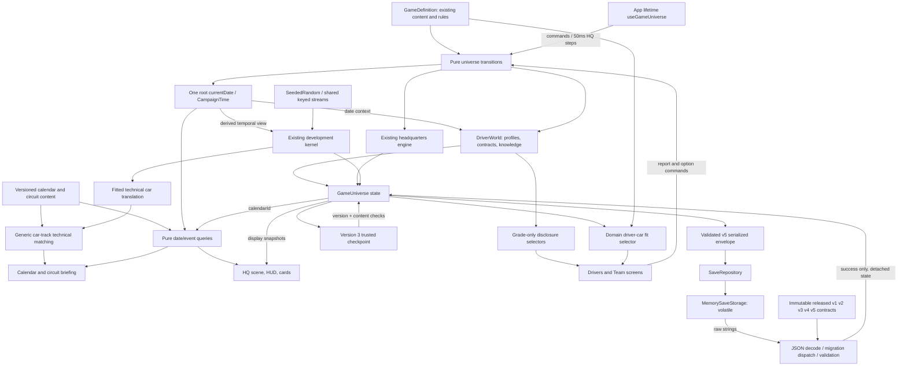

# System map

Solid connections below exist today. Everything in the future table is design, not working code.

| Boundary | Data passed | Must not happen |
|---|---|---|
| App -> HQ transition | Latest universe, definition, finite dt | Frame time advancing weeks |
| Explicit week command -> development | Existing world/context | React implementing project rules |
| NEW DAY -> HQ reset | Existing layout and roster | Wiping development budgets or history |
| Snapshot -> renderer | Worker states/routes, room data | Animation changing authoritative positions |
| Checkpoint -> restore | Trusted versioned plain-data snapshot | Treating this as a file parser |
| Definition -> engines | Stable part/team/station/event IDs | Duplicated runtime state in static data |

Future integrations:

- Expanded driver growth/offseason -> people/contract state -> player-visible estimates.
- Existing technical vector/track suitability -> future qualifying/race engines.
- Weekend commands + forecast/tyres/traffic -> simulation events/results -> standings/history.
- Development commitments, salaries and sponsor obligations -> one finance ledger.
- Results/personnel changes -> morale/market/world events -> choices and news projections.
- Season transition -> archive official results -> contracts/retirements/regulations -> next calendar.
- Validated storage adapter -> migration chain -> universe restore; never UI-owned migration rules.

Keep subsystem APIs independently callable for fast fixtures and tools. Share IDs, clock decisions,
checkpoint boundary and RNG conventions; isolate HQ geometry, project rules, future race rules and
platform storage. Introduce typed events when a real consumer exists, not a global mutable bus now.

## Facility and brand connections (planned, not implemented)

Canonical organization/brand ID -> identity/history/personality -> differentiated AI policies.
Canonical facility definitions + team-owned lifecycle state -> capability/capacity selectors ->
development/staff/reliability/logistics/preparation; the SAME lifecycle state -> HQ visual
variant selector -> construction/commissioned/active appearance. Finance ledger later owns
construction/upkeep charges. No second copy of capability in the renderer and no duplicate
charges/bonuses in legacy development. EVERY major upgrade needs simulation AND visible effects.

The canonical registry is `src/game/brandRegistry.ts`; the working grid and sponsor/other
brand policy live in BRAND_IDENTITY.md. Saves/history use entity IDs, registry lookups supply
names/art. Track geography/profile IDs are independent from commercial event branding.
B retains the ten-team fixture for v1 validation and maps its runtime references into the
canonical eleven-team definition. See the B migration notes; new games do not use the old grid.

Only the memory adapter is implemented today. Native/browser storage belongs behind SaveStorage;
the simulation imports neither platform storage nor persistence. Repository decode never mutates
an active session; a future explicit application load action may replace state only after success.

## C0.1 single-clock boundary

GameUniverse.currentDate -> CampaignTime -> derived development/contract/display contexts.
Persisted development and DriverWorld contain no current clocks. The balanced development
kernel's dated view is temporary; its season/week fields are never stored. Date advancement
processes the ordered interval, running existing weekly work and explicit option/expiry checks.
Future dated systems join this interval; a target-date jump cannot skip their intermediate work.

V1/V2 -> frozen validated V3 -> date migration -> frozen validated V4 -> calendar identity -> V5 validation. Source snapshots and
fixtures remain untouched. The v4 fixture preserves C0's meaningful audited progress.

UI -> domain date/day selectors; current HQ NEW DAY -> animation replay, never the campaign
clock. The next-event HUD now reads the immutable event registry. Calendar year,
championship lifecycle, dated facts and HQ milliseconds are different concepts.

C0's clock inventory/migration plan is historical context; C0.1 implements the approved actual-
date model. Provisional annual March2/52-work-week projection preserves old progress until real
calendar/phase definitions replace it through an explicit compatibility step. C leaves that phase policy intact.

## C calendar/content and technical boundaries

- `game/calendar`: append-only calendar.2026.v1 -> stable events/track IDs/profiles; recursive
  freeze and authoring validation. Career stores only the ID, never a copied registry.
- `simulation/calendar`: rootDate + ID -> current/next/previous/future/status/countdown and
  score-free detail disclosure. Calendar status cannot generate a result.
- `simulation/trackPerformance`: fitted development -> existing attribute/package/reliability
  semantics -> technical vector -> generic demand comparison -> qualitative briefing.
- Driver/car comfort is separate and unchanged. No performance logic in CalendarScreen or HUD.
- Save4 source semantics/fixture -> validated ID attachment -> save5; no source fixture edits.
- Old weekly development fixture remains internal compatibility content; connecting actual race
  weekends to fitting/development processing requires a later explicit policy/migration decision.
- Research gate: initial authored weights are implemented/tested; authoritative circuit-source
  verification is blocked by the cloud allowlist. Do not confuse this with completed research.
