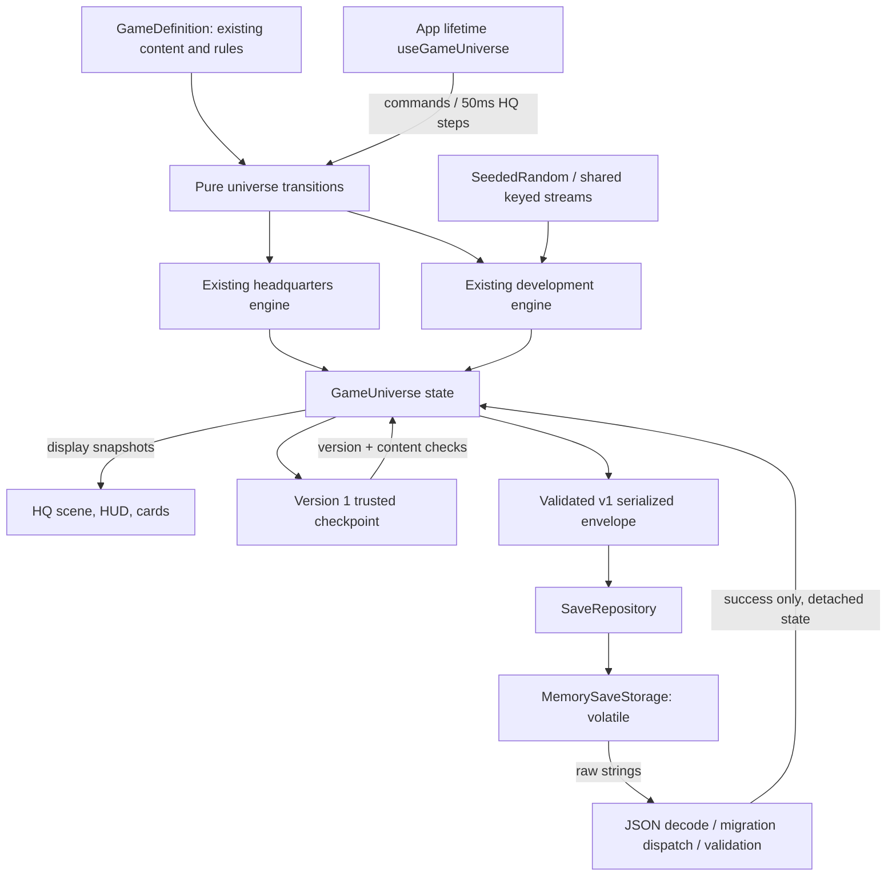

# System map

Solid connections below exist today. Everything in the future table is design, not working code.

| Boundary | Data passed | Must not happen |
|---|---|---|
| App -> HQ transition | Latest universe, definition, finite dt | Frame time advancing weeks |
| Explicit week command -> development | Existing world/context | React implementing project rules |
| NEW DAY -> HQ reset | Existing layout and roster | Wiping development budgets or history |
| Snapshot -> renderer | Worker states/routes, room data | Animation changing authoritative positions |
| Checkpoint -> restore | Trusted versioned plain-data snapshot | Treating this as a file parser |
| Definition -> engines | Stable part/team/station/event IDs | Duplicated runtime state in static data |

Future integrations:

- Driver/scouting/contract commands -> people/contract state -> player-visible estimates.
- Part specs -> car characteristic vector -> track-weighted performance -> qualifying/race engines.
- Weekend commands + forecast/tyres/traffic -> simulation events/results -> standings/history.
- Development commitments, salaries and sponsor obligations -> one finance ledger.
- Results/personnel changes -> morale/market/world events -> choices and news projections.
- Season transition -> archive official results -> contracts/retirements/regulations -> next calendar.
- Validated storage adapter -> migration chain -> universe restore; never UI-owned migration rules.

Keep subsystem APIs independently callable for fast fixtures and tools. Share IDs, clock decisions,
checkpoint boundary and RNG conventions; isolate HQ geometry, project rules, future race rules and
platform storage. Introduce typed events when a real consumer exists, not a global mutable bus now.

## Facility and brand connections (planned, not implemented)

Canonical organization/brand ID -> identity/history/personality -> differentiated AI policies.
Canonical facility definitions + team-owned lifecycle state -> capability/capacity selectors ->
development/staff/reliability/logistics/preparation; the SAME lifecycle state -> HQ visual
variant selector -> construction/commissioned/active appearance. Finance ledger later owns
construction/upkeep charges. No second copy of capability in the renderer and no duplicate
charges/bonuses in legacy development. EVERY major upgrade needs simulation AND visible effects.

The future canonical registry is `src/game/brandRegistry`; the working grid and sponsor/other
brand policy live in BRAND_IDENTITY.md. Saves/history use entity IDs, registry lookups supply
names/art. Track geography/profile IDs are independent from commercial event branding.
The existing ten-team development fixture is intentionally not renamed during A.1.

Only the memory adapter is implemented today. Native/browser storage belongs behind SaveStorage;
the simulation imports neither platform storage nor persistence. Repository decode never mutates
an active session; a future explicit application load action may replace state only after success.
