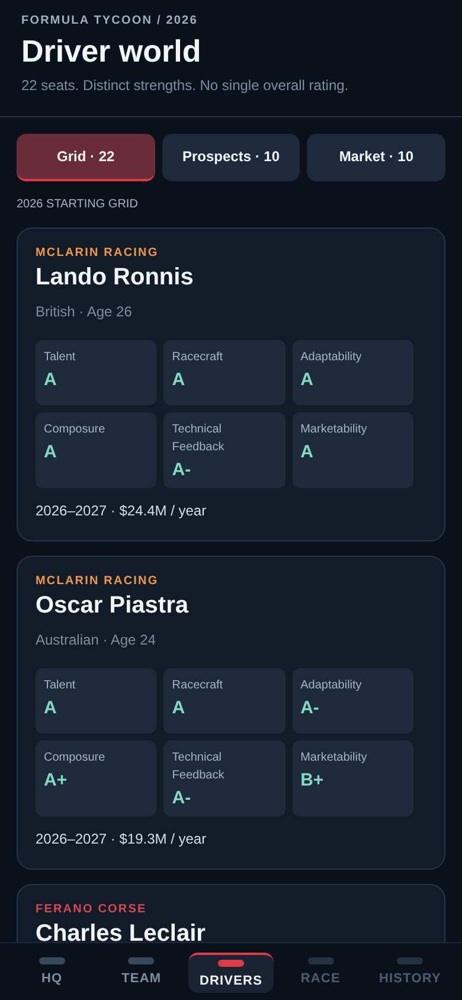
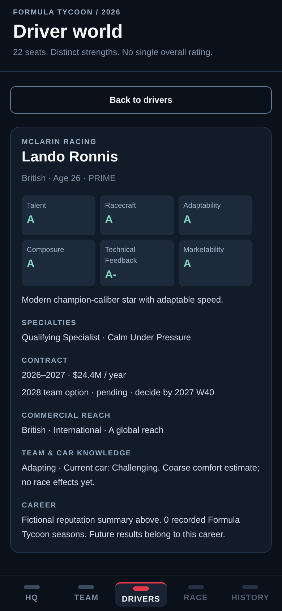
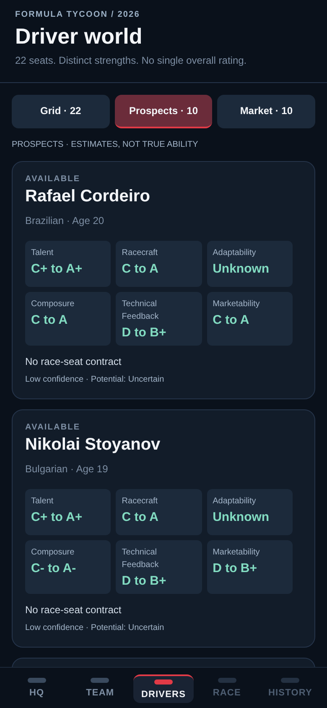
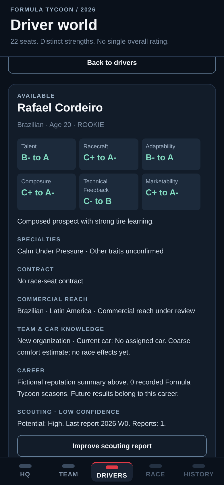
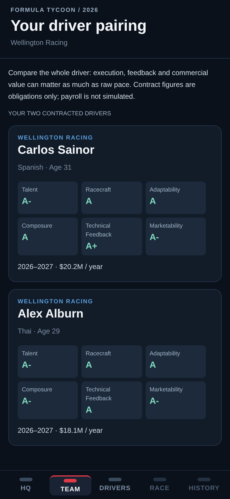
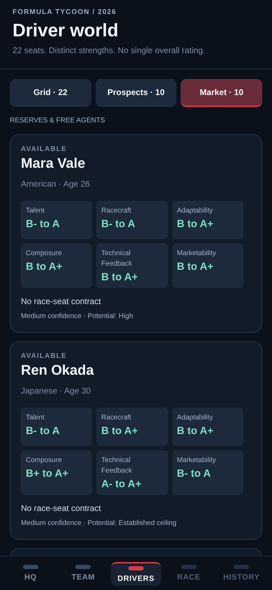

# Milestone B mobile browser previews

390 × 844 viewport, captured at 2× density in Chromium. Not native iPhone screenshots.
No overall driver score or raw internal ability/potential is displayed.

## Grid

## Driver detail

## Prospects

## Scouting

## Team pairing

## Reserve market

